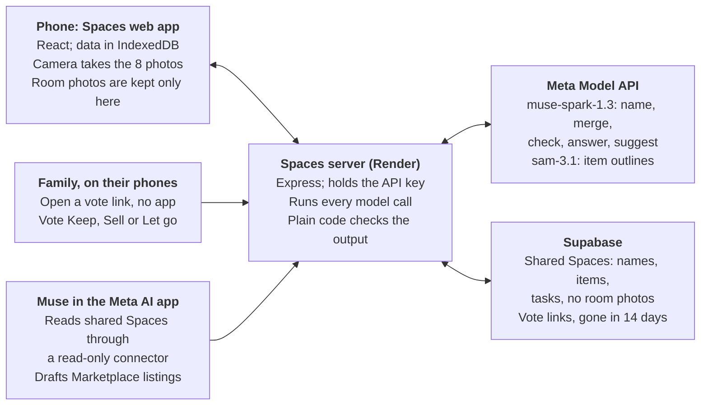

# Spaces design doc

Shashank Kaveti · Nov 3, 2026

Spaces turns a phone scan of a room into structured home context (Things, People, Decisions, Tasks) and hands it to Muse. AI decides what things are; plain code checks, counts and keeps every number. On 3 real rooms it found 45 of 57 listed things in about 3 minutes a room.

## Goals and non-goals

**Goals**

- Build an inventory of a room from 8 phone photos, good enough that a person corrects it rather than types it.
- Help a person decide what to keep, sell or let go, alone or with family, without a thread of photos and texts.
- Track the chores a home needs, tied to the Things they're for.
- Give Muse context about the home, in the app and in the Meta AI app, with the person choosing what's shared.
- Never lose an item silently, and never let Muse cite something that isn't in the inventory.

**Non-goals (for now)**

- Accounts and multi-device sync: data lives on the phone; only shared Spaces and vote links reach a server.
- Posting to Marketplace or WhatsApp directly: neither has a public API for this. Spaces drafts; the person posts.
- True spatial mapping (floor plans, item positions in 3D).
- Detecting people: they're added by hand and never treated as inventory.

## Product model

Every screen either adds to this model or puts it to use. The words on screen are the model's words.

| Part | What it is | Where it comes from | Stored |
| --- | --- | --- | --- |
| Space | A room, a backyard, any named place | Named by the person, then scanned in 8 photos | Phone |
| Things | Items in a Space: name, category, quantity, photos, outline | The scan, or added by hand; "Not sure" items stay for the person to decide | Phone |
| People | Who shares the home, and which Spaces each uses | Added by hand, never detected; phone numbers never leave the phone | Phone |
| Decisions | Keep, Sell or Let go per Thing, with price and listing for Sell | Decluttering one by one, or a family vote link | Phone; vote links in Supabase for 14 days |
| Tasks | Chores on a Space, how often, next due, who, and the Things they're for | By hand, or suggested by Muse; plain code sets the dates | Phone |
| Muse | Ask Muse in the app, and Muse in the Meta AI app | Reads the model; a shared Space goes to the server for the Meta AI app | Shared Spaces in Supabase |

`web/src/spaceGraph.js` links Space, area, category, item, photo and task into one graph, giving each item a short reference (`i3`) that its tasks also use. That graph is Ask Muse's context, and the references are how answers cite items.

## Architecture

Room photos are kept only on the phone; only what is shared reaches the database.

The phone holds the home and talks only to the Spaces server, which holds the API key and runs every model call. Supabase keeps just shared Spaces and vote links, which family phones and Muse in the Meta AI app reach through the server.

## Recognition pipeline

A scan becomes an inventory in six steps; Muse makes the judgments and plain code checks each one (`server/src/inventory.js`).

1. **Capture (phone).** The person stands in the middle of the Space and turns right through 8 directions, 45° apart. The camera takes each photo by itself when the phone is lined up and still, on the 1× lens.
2. **Name (Muse Spark, 8 calls in parallel).** For each photo: the items in it, a category, a short description, and a rough location. Spark also marks whether each item is in the named Space or in a neighbouring area.
3. **Outline (SAM 3.1).** SAM finds every match for each item's name. Plain code keeps the outline that matches Spark's rough location, since "sofa" finds every sofa.
4. **Merge (Muse Spark, 1 call).** Spark decides which sightings across overlapping photos are the same item. Code flags items cut at the edge of neighbouring photos as hints, and allows merges along a chain of photos.
5. **Check (plain code).** Every merge is checked against the photo layout, quantities are counted, and each item gets its best crop. People and pets are removed, whatever the model returned.
6. **Confirm crops (Muse Spark, 1 call).** Spark looks at each crop to confirm it shows the item. A doubtful item stays in the list, marked "Not sure", rather than disappearing.

The server streams progress to the phone as lines of JSON, with a "still working" line every 15 s so a long merge doesn't look like a dropped connection. Recognition runs outside the results screen, so a person can look around while it finishes, one Space at a time.

**Adding to a Space later** (another spot, or photos of a corner): only the new photos are recognised. Muse Spark compares new items with existing ones by picture (`repeats.js`), and likely repeats wait for the person to confirm; nothing is merged silently.

## Key decisions

| Decision | Alternatives considered | Why |
| --- | --- | --- |
| Spark points at each item; SAM only sharpens the outline | SAM alone from a word; Spark boxes alone | SAM finds every match for a word ("10× wall art" for one picture); Spark's boxes are too rough to crop |
| 8 still photos, 45° apart, taken automatically | A video sweep; free photos | Still photos are sharp and coverage is predictable; a sweep shows the same sofa many times |
| AI judges, plain code counts and checks | Trust model output as-is | Quantities, dates, prices and citations must be right every time; code checks every merge and drops any citation not in the inventory |
| Keep doubtful items, marked "Not sure" | Drop low-confidence items | The crop check also rejected real small items; the person decides, nothing is lost silently |
| Standard `muse-spark-1.3`, never `-contributor` | The `-contributor` models the credits cover | Their inputs may be used for training, and home photos can show people |
| Data on the phone (IndexedDB); no accounts | A backend with accounts | Faster to build, and private by default; only shared Spaces and vote links reach a server |
| Share with Muse is per Space, off by default | Share everything | The person chooses what Muse sees, and the switch says what leaves the phone before anything does |
| A read-only key-based connector for the Meta AI app | A write API; a Meta SDK | Muse can build a custom connector from a key-based API; read-only means nothing can change data through it |
| Draft listings and vote links; the person posts | Post to Marketplace or WhatsApp directly | Marketplace has no public listing API; the WhatsApp Cloud API needs business approval and templates |
| One task covers every Thing cared for the same way | One task per Thing | "Water the plants" with 15 plants is one chore to a person; Muse groups, plain code merges duplicates and sets dates |
| Ask Muse sends the inventory with each question | Store inventories on the server | Nothing private has to be stored server-side to answer a question |

## Privacy and data

Room photos never leave the phone except to the Meta Model API for recognition, and nothing reaches a database unless the person shares it.

| Data | Where it lives | Who can reach it |
| --- | --- | --- |
| Room photos, Things, People, Decisions, Tasks, chats | The phone (IndexedDB) | The phone only |
| Photos during recognition | Sent to the Meta Model API through the server; not kept by the server in production | Meta's API (SAM calls use `store: false`) |
| A shared Space: names, item lists, tasks, up to 3 small sale photos per Sell item | Supabase `shared_spaces`, row level security with no policies | The server's secret key; the read-only connector with its key |
| A family vote link: item names, 320 px pictures, asking prices, voters' names | Supabase `vote_links` and `vote_answers`, deleted after 14 days | Anyone with the link; the owner keeps the token, the server keeps its hash |
| Scan photos in development | A git-ignored folder on the developer's machine | The developer only, to measure recognition |

People are added by hand and never detected; names, phones and relationships stay on the phone. Before a first scan, the app says that photos go to Meta's AI models and asks people to keep others, especially children, out of frame.

## Results and limits

On 3 real rooms in one home, Spaces found 45 of the 57 things the owner listed by hand (79%), in 171 to 202 s a room. One scan per room and one person's list: a sample that shows behaviour, not a general rate ([ACCURACY.md](ACCURACY.md)).

- **Misses** are small things on other surfaces, wall fixtures and things hung on a rack. 3 items were found but filed as nearby, and 3 had the wrong count.
- **Time:** the single merge call is 60 to 66% of every scan.
- **Variation:** the same photos give somewhat different lists on reruns.
- **Irregular Spaces:** 8 photos from one spot miss corners out of view. Adding a second scan from another spot works, with repeats confirmed by the person.
- **Tested:** during development, 15 browser test scripts drove every screen with fake recognition (they aren't in the repo yet); recognition itself is measured on saved real scans with `npm run test:inventory`. Checked by hand on an iPhone.

## Next

1. **Speed up the merge.** Split it by area or photo pair, or stream partial results, so a scan isn't two minutes of waiting.
2. **Plant care from the scan.** Muse names the plants it found and suggests how often to water each, as tasks.
3. **Accounts and sync,** so a household shares one home across phones, with Supabase holding shared Spaces.
4. **Spatial mapping for irregular Spaces,** with Apple's RoomPlan in a native app or by matching items between scans.
5. **Memories on Things,** the stories behind what's kept, as more context for Muse.
6. **Measure more homes,** several runs each, before quoting an accuracy rate.
